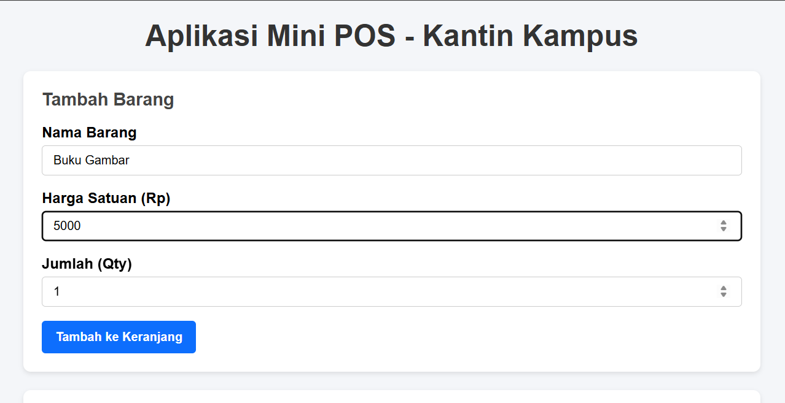
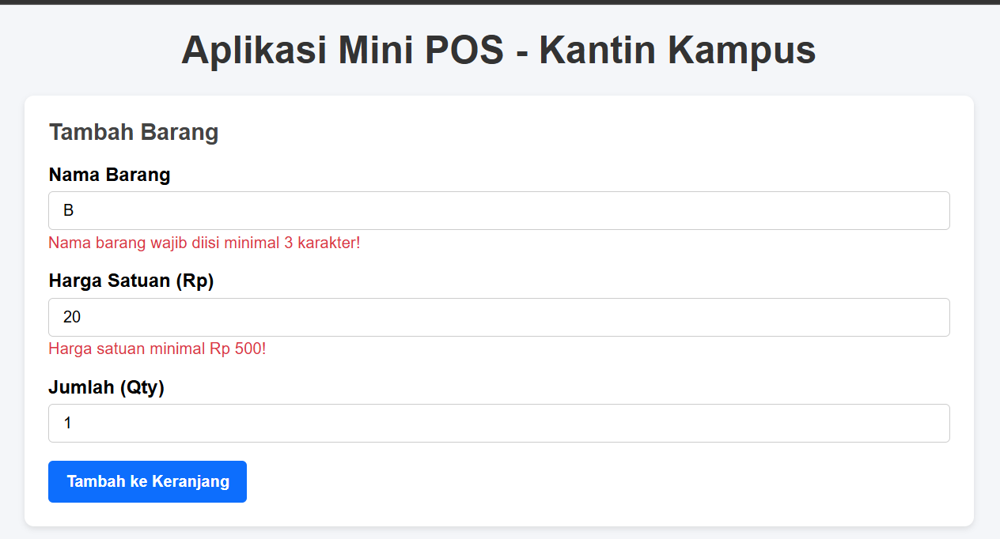
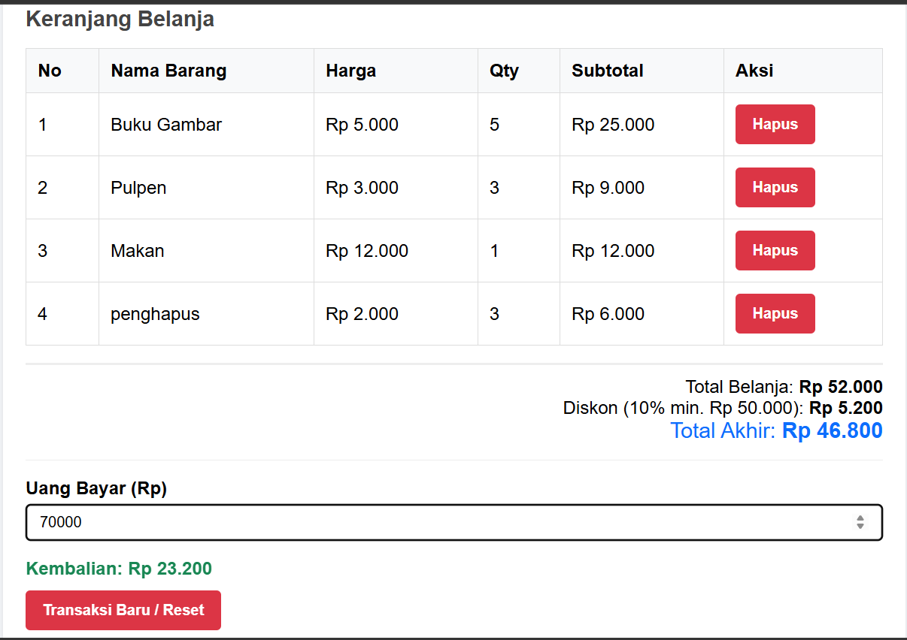

# Tugas Praktikum Web - Mini POS Kantin Kampus

## Identitas
- **Nama**: Ribka Deuina Manik
- **NIM**: 124140014
- **Kelas**: RA

## Deskripsi Aplikasi
Aplikasi Mini POS (Point of Sale) adalah aplikasi kasir sederhana yang dirancang untuk kebutuhan transaksi kantin kampus. Aplikasi ini membantu pengguna mencatat barang belanjaan, mengkalkulasi harga total beserta diskon secara otomatis, menghitung kembalian pembayaran, serta menyimpan data keranjang secara persisten pada browser.

## Cara Menjalankan Aplikasi
1. Clone atau download repository ini.
2. Buka folder `ribkadeuinamanik_124140014_pertemuan1`.
3. Buka file `index.html` langsung di browser atau jalankan menggunakan ekstensi **Live Server** di VS Code.

## Checklist Fitur
- [x] Validasi form input (Nama minimal 3 karakter, harga >= 500, Qty >= 1)
- [x] Perhitungan Subtotal dan Total Belanja otomatis
- [x] Diskon otomatis 10% jika total belanja >= Rp 50.000
- [x] Kalkulator Uang Bayar dan Kembalian
- [x] Fitur Hapus Item dari keranjang
- [x] Penyimpanan persisten menggunakan `localStorage`
- [x] Tombol Reset transaksi

## Screenshot
**1. Tampilan form input utama**

**2. Tampilan saat validasi error muncul**

**3. Tampilan hasil perhitungan dan tabel keranjang**

## Penjelasan Teknis Singkat
1. **Validasi Input**: Menggunakan fungsi `validateForm()` yang mengecek tiap kondisi batas sebelum data dimasukkan ke array `cart`.
2. **Kalkulasi Dynamic**: Menggunakan array method seperti `forEach()` dan `reduce()` untuk menghitung subtotal dan grand total setiap kali keranjang diubah.
3. **Mekanisme Persistensi**: Data array `cart` diserialisasi menggunakan `JSON.stringify()` saat disimpan ke `localStorage`, dan di-parse kembali menggunakan `JSON.parse()` saat aplikasi dibuka pertama kali.
