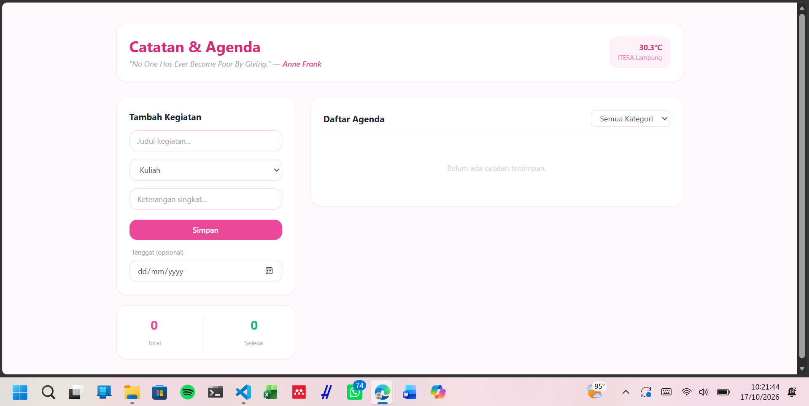
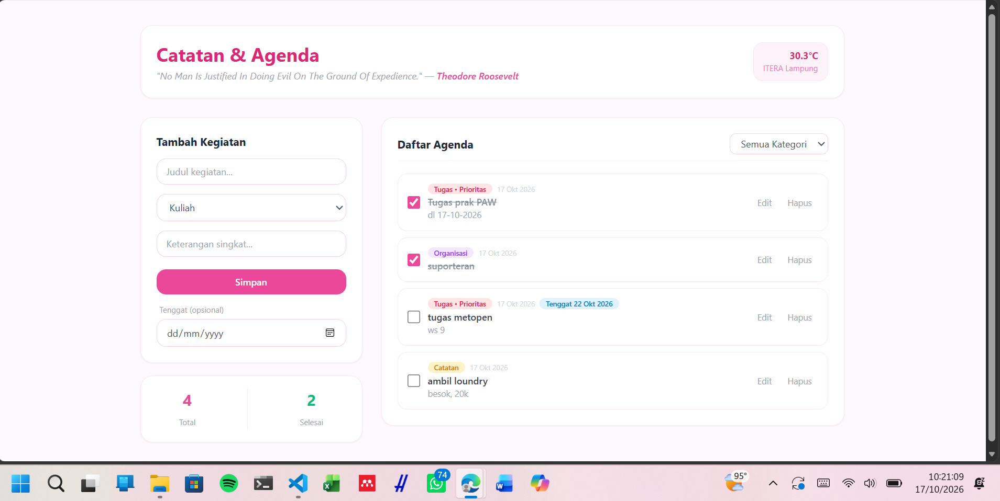

# ITERA Student Dashboard Application

Aplikasi Personal Dashboard interaktif yang dirancang untuk memenuhi kebutuhan mahasiswa ITERA dalam mengelola agenda kuliah, tugas, dan catatan harian secara terorganisir.

## Fitur Utama
1. **Interactive Task & Notes Tracker**: Fitur Tambah, Edit, Hapus (CRUD), dan centang untuk agenda harian.
2. **Kategori & Filter**: Pengelompokan berdasarkan kategori Kuliah, Tugas, Catatan, dan Organisasi.
3. **Penyimpanan Lokal (localStorage)**: Data tersimpan di browser sehingga tidak hilang saat halaman direfresh.
4. **Widget Cuaca Real-Time**: Mengambil data suhu aktual wilayah Kampus ITERA (Lampung) melalui Open-Meteo API.
5. **Kutipan Motivasi Harian**: Integrasi API acak untuk dorongan semangat belajar.
6. **Penanda Tenggat (Deadline)**: Tiap kegiatan bisa diberi tanggal tenggat dan otomatis diberi label "Terlambat", "Hari ini", atau tanggal tenggatnya.

---

## Screenshot Antarmuka Aplikasi

---

## Daftar Fitur ES6+ yang Diimplementasikan

| No | Fitur ES6+ | Lokasi File & Baris | Deskripsi Implementasi |
|---|---|---|---|
| 1 | **`let` & `const`** | `js/dashboardApp.js` (Baris 62, 64, 155) | `const` untuk nilai tetap, `let filteredTasks` di-reassign saat filter kategori aktif. |
| 2 | **Arrow Functions** | `js/modules/utils.js` (Baris 4, 11) `js/dashboardApp.js` (Baris 77, 82, 84, 172, 215) `js/modules/TaskItem.js` (Baris 57) | Fungsi utilitas `formatDate`, `capitalize`, callback event handler, `map` render, dan factory `createTask`. |
| 3 | **Template Literals** | `js/dashboardApp.js` (Baris 39-42, 54, 164-168, 183-212) `js/modules/TaskItem.js` (Baris 40, 52) | Backtick untuk menyusun kartu HTML dinamis, badge, dan interpolasi variabel. |
| 4 | **Async/Await** | `js/dashboardApp.js` (Baris 19, 32, 49) | Mengambil data cuaca (Open-Meteo) dan kutipan (DummyJSON) dengan `try/catch`. |
| 5 | **Promise.all** | `js/dashboardApp.js` (Baris 23) | Cuaca dan kutipan diambil secara paralel. |
| 6 | **Classes & Inheritance** | `js/modules/TaskItem.js` (Baris 4, 45-54) `js/dashboardApp.js` (Baris 5) | `TaskItem`, subclass `AssignmentTask extends TaskItem` dengan `super()` dan override `getLabel()`, serta `DashboardApp` sebagai pengelola state. |
| 7 | **Destructuring** | `js/dashboardApp.js` (Baris 37, 53, 66, 173, 218) | Mengekstrak properti dari response API, parameter callback `loadLocalStorage()`, task, dan `dataset`. |
| 8 | **Spread Operator (`...`)** | `js/dashboardApp.js` (Baris 104) | `[...this.tasks, newTask]` menambah data tanpa mutasi langsung (immutability). |
| 9 | **Default Parameters** | `js/modules/TaskItem.js` (Baris 6-14) | Nilai bawaan untuk `id`, `category`, `detail`, `isCompleted`, `createdAt`, `deadline`. |
| 10 | **Modern Array Methods** | `js/dashboardApp.js` (Baris 66, 97, 113, 119, 157, 161, 172) | `map`, `filter`, `find` untuk mengolah daftar tugas. |
| 11 | **ES Modules** | `js/main.js`, `js/dashboardApp.js` (Baris 1-3), `js/modules/*` | `import`/`export` dengan `type="module"`. |