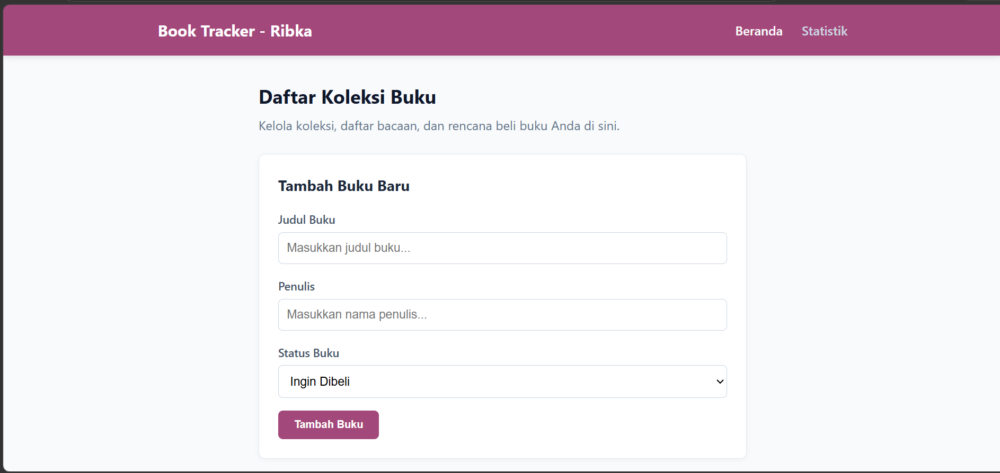
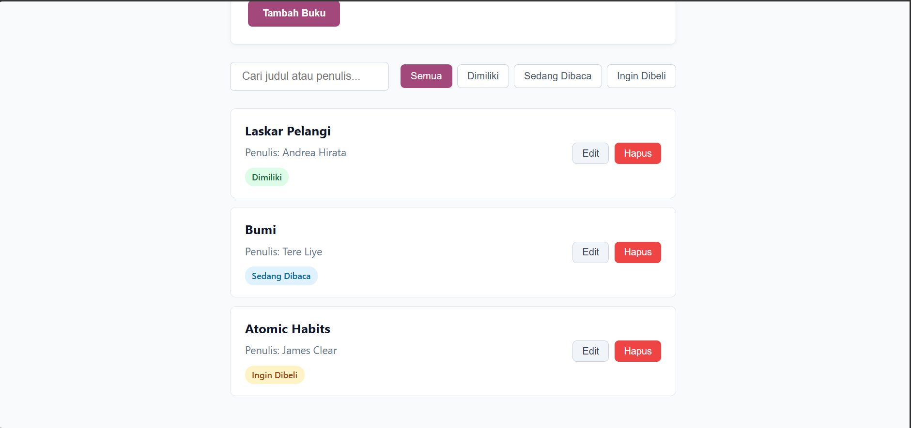
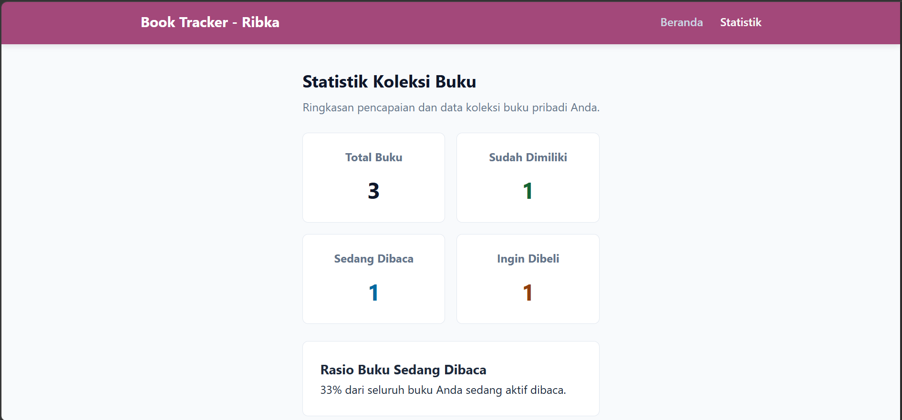
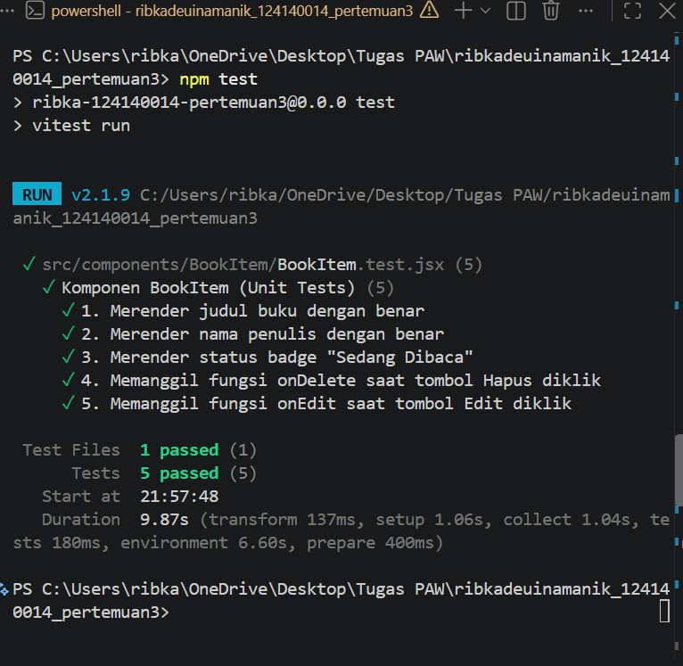

# Aplikasi Manajemen Buku Pribadi

Aplikasi web Single Page Application (SPA) berbasis React untuk mengelola koleksi buku pribadi (buku yang dimiliki, sedang dibaca, atau ingin dibeli).

## Fitur Utama
- **CRUD Buku:** Menambah, mengedit, dan menghapus data buku.
- **Pencarian & Filter:** Menyarikan buku berdasarkan judul/penulis serta status.
- **Statistik Koleksi:** Menampilkan ringkasan data koleksi dan rasio buku yang sedang dibaca.
- **Penyimpanan Persisten:** Menggunakan `localStorage` agar data tersimpan di peramban.
- **Validasi Form:** Error handling visual ketika kolom input wajib belum diisi.

## Konsep React yang Diterapkan
1. **Component-Based Architecture:** Pembagian UI menjadi komponen independen (`BookForm`, `BookItem`, `BookList`, `BookFilter`, `Navbar`).
2. **Custom Hooks:**
   - `useLocalStorage.js`: Penanganan sinkronisasi data ke LocalStorage.
   - `useBookStats.js`: Logika perhitungan statistik buku.
3. **Context API (`BookContext.jsx`):** State management global tanpa prop drilling.
4. **React Router (`react-router-dom`):** Routing multi-halaman (`/` dan `/stats`) tanpa reload peramban.
5. **PropTypes:** Validasi tipe data props pada komponen `BookItem` dan `BookProvider`.
6. **Unit Testing:** 5 unit test menggunakan Vitest & React Testing Library.

## 🧪 Hasil Pengujian Unit Test






## Jalankan Proyek

```bash
# 1. Install dependensi
npm install

# 2. Jalankan Dev Server
npm run dev

# 3. Jalankan Testing
npm test