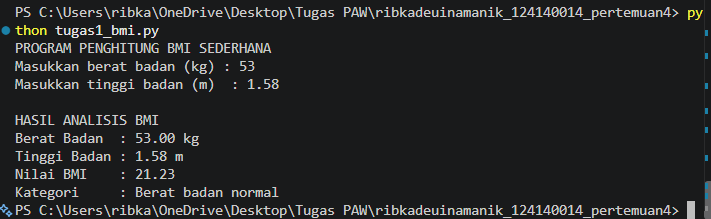
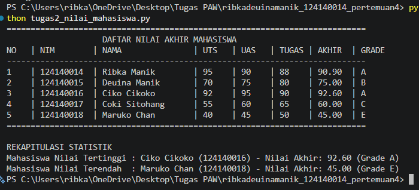
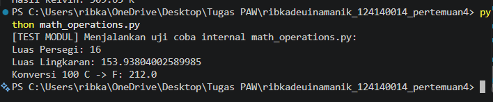
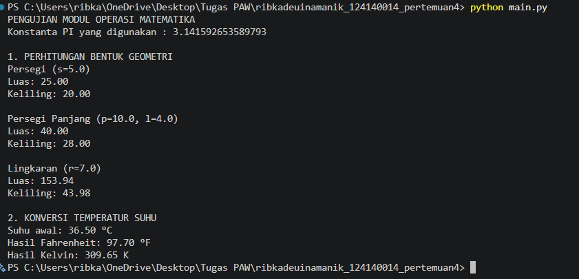

# Praktikum Pemrograman Aplikasi Web - Pertemuan 4
**Dasar-Dasar Pemrograman Python**

## Identitas Mahasiswa
* **Nama:** Ribka Deuina Manik
* **NIM:** 124140014

---

## Deskripsi Alur Kerja & Fungsi Program

### 1. `tugas1_bmi.py` (Program Penghitung Body Mass Index (BMI))
* **Alur Kerja:** Meminta input berat badan (kg) dan tinggi badan (m) dari pengguna, memvalidasi agar nilai lebih dari 0, menghitung nilai BMI, lalu mengklasifikasikannya ke dalam 4 kategori (*Berat badan kurang*, *Berat badan normal*, *Berat badan berlebih*, atau *Obesitas*).
* **Fungsi Utama:**
  * `hitung_bmi(berat_kg, tinggi_m)`: Mengembalikan nilai rasio BMI menggunakan rumus $\text{berat} / \text{tinggi}^2$.
  * `tentukan_kategori_bmi(bmi)`: Mengevaluasi nilai BMI menggunakan percabangan `if-elif-else` dan mengembalikan status kategori dalam bentuk `str`.

### 2. `tugas2_nilai_mahasiswa.py` (Program Pengelolaan Data Nilai Mahasiswa)
* **Alur Kerja:** Melakukan iterasi pada 5 data mahasiswa, menghitung nilai akhir berdasarkan bobot persentase (30% UTS + 40% UAS + 30% Tugas), menentukan grade huruf (`A` - `E`), mencetak seluruhnya dalam format tabel, serta mencari mahasiswa dengan nilai akhir tertinggi dan terendah menggunakan fungsi `max()` dan `min()`.
* **Fungsi Utama:**
  * `hitung_nilai_akhir(uts, uas, tugas)`: Menghitung nilai akhir sesuai bobot mata kuliah.
  * `tentukan_grade(nilai_akhir)`: Mengonversi skor angka menjadi huruf `A` sampai `E`.

### 3. `math_operations.py` & `main.py` (Modul Matematika Kustom)
* **Alur Kerja:** `main.py` mengimpor modul `math_operations` menggunakan 2 gaya sintaks impor berbeda (`import math_operations as mo` dan `from math_operations import ...`), lalu mengeksekusi seluruh fungsi geometri dan konversi suhu dengan data uji.
* **Konstanta & Fungsi pada `math_operations.py`:**
  * `PI`: Konstanta bernilai `3.141592653589793`.
  * `luas_persegi(sisi)` & `keliling_persegi(sisi)`: Menghitung luas dan keliling persegi.
  * `luas_persegi_panjang(panjang, lebar)` & `keliling_persegi_panjang(panjang, lebar)`: Menghitung luas dan keliling persegi panjang.
  * `luas_lingkaran(r)` & `keliling_lingkaran(r)`: Menghitung luas dan keliling lingkaran.
  * `celsius_ke_fahrenheit(celsius)` & `celsius_ke_kelvin(celsius)`: Konversi suhu dari Celsius ke Fahrenheit dan Kelvin.

---

## Instruksi Menjalankan Program

1. Buka folder proyek `ribkadeuinamanik_124140014_pertemuan4` di Visual Studio Code.
2. Buka Terminal menggunakan pintasan **`Ctrl + ` `**
3. Jalankan masing-masing berkas skrip dengan perintah berikut:

* **Menjalankan Tugas 1 (Penghitung BMI):**
  ```bash
  python tugas1_bmi.py
  ```
* **Menjalankan Tugas 2 (Pengelolaan Nilai Mahasiswa):**
  ```bash
  python tugas2_nilai_mahasiswa.py
  ```
* **Menjalankan Tugas 3 (Program Utama Modul Matematika):**
  ```bash
  python main.py
  ```

---

## Screenshot Hasil Eksekusi Program

### 1. Output Tugas 1 (`tugas1_bmi.py`)


### 2. Output Tugas 2 (`tugas2_nilai_mahasiswa.py`)


### 3. Output Tugas 3 (`main.py` dan `math_operations.py`)

